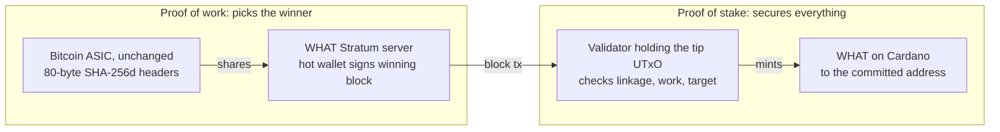

# Proof of What?

Version 1.0 — 31 October 2026, 18:10 UTC

## Abstract

Proof of What? (WHAT) is a chain in which proof of work is decoupled from security and operates only as an issuance lottery. Miners run Bitcoin's SHA-256d algorithm against a chain of headers; each winning header mints WHAT tokens to a Cardano address committed inside it, issued as Cardano Native Tokens. As a result, validation, ordering, double-spend prevention and timekeeping all happen on Cardano's proof-of-stake ledger.

The host ledger is not incidental; three of its properties are load-bearing. It settles under proof of stake, so the reward is paid in a token whose value does not depend on the hashpower it attracts — which is the one thing a proof-of-work chain paying for its own security cannot do. It is a UTxO ledger, where a balance is a set of discrete unspent outputs rather than a number in an account, so the WHAT chain's tip is a single output and two miners who solve the same height contend to spend it: the ledger takes one, rejects the other before any script runs, and charges the loser nothing. And its tokens are issued by the ledger rather than held as balances inside a contract, so a mined reward arrives as an output in the winner's wallet and spends like any other — the presentation a Bitcoin coinbase has, with no further involvement from the mining validator.

WHAT keeps what Bitcoin got right: a 21 million supply cap and no premine. It drops the compromises a chain only makes when proof of work must also secure it. Difficulty adjusts on every block, rising as fast as hashpower arrives and falling in real time when blocks are slow, instead of waiting out a 2,016-block retarget. Block time comes from Cardano's ledger, not from timestamps miners report about themselves. Two miners who solve the same block cannot fork the chain: Cardano accepts one and rejects the other, so WHAT has no forks of its own; its finality is Cardano's.

The WHAT chain's hashpower secures nothing by itself, by design. The chain is a measurement engine: a hash spent here cannot also count toward a block anywhere else, so every hash it attracts is one that chose this chain over whatever else that hardware was doing. Because WHAT lives on a PoS ledger, the demonstration is funded by an instrument whose value does not depend on the hashpower it attracts. The question in the name is what the chain records: proof of work shows that work was done, not what the work was for, so what WHAT writes down is the difficulty each block was won at, how much work turned up, and how long it kept turning up.

## 1. Motivation

Proof of work is a lottery. Each hash is a ticket; the winner of each draw chooses the next block and collects the coinbase. The ticket competition makes attacks expensive, and that expense is what Bitcoin calls security.

The argument rests on an assumption it cannot check: that honest, online hashpower dominates, and that idle or offline capacity will never be mobilized against it. We call this the **offline hashpower mis-incentive**. No protocol rule measures the reserve, and nothing in the protocol prevents online hashpower from being paid to go elsewhere.

Past attempts to test this were self-limiting. A PoW token that pays for hashpower loses its value when that hashpower leaves, so the value of the token it pays collapses with it. Proof of What? pays in a token secured by stake, so hashpower can come and go without devaluing it. The test is victimless: no chain is attacked, no party is targeted, no coins are double-spent. Hashpower simply chooses where to go, or whether to come back online, and the chain publishes where it ends up.

## 2. What the block reward buys

In a permissionless blockchain, the block reward pays for one thing: producer selection, who extends the chain next. Names are free, so the right to produce has to be bought with something, or one operator can be a thousand identities. In Bitcoin the tickets are hashes; under Ouroboros they are stake. As Sybil defenses the two are symmetric: each makes control of selection cost more than control pays.

Bitcoin credits the same payment with a second thing: ordering, which of several conflicting but individually valid histories is canonical, and what it costs to revise one at depth. That cost is denominated in the same hashes the reward buys, so the spend that selects producers is counted as the security of the history they produce. Nothing in the protocol separates the two to show how much of one the other actually buys.

Validity, what the rules accept, is bought by neither system's reward: nodes enforce it unpaid, and no quantity of hashpower changes it (section 11).

WHAT separates selection from ordering. Ordering is Cardano's, denominated in stake, and so is the selection of the producers who make the blocks WHAT lives in. The work selects only who is paid the next reward. WHAT pays Bitcoin's full reward schedule for a selection that secures nothing, with ordering already settled by stake, and records what the hashpower does next. That record is a reading of what the credit was worth.

What makes it a reading is the one respect in which hashes and stake are not symmetric. Hashes are a flow: hardware and electricity are committed to SHA-256d, not to any chain, and pointing them at a chain buys no position in it. A miner follows the protocol because the reward is the best available use of its hardware, and when something pays better it leaves at no loss. Stake is a stock: it has to be bought in the chain's own asset, cannot be moved to another network, and a producer that breaks the protocol lowers the value of what it holds. That is a difference in what the resource is, not a ranking of the two mechanisms, and this paper makes no claim about which secures better.

Proof of What? is therefore a proof-of-stake chain; section 3 describes the one job the work has. Whether stake holds ordering as well as work does is Ouroboros's claim to defend, and it defends it in the peer-reviewed record. This design inherits that answer with its assumptions, an honest majority of stake among them, and a reader who rejects the claim should reject this chain with it.

## 3. Design overview

Proof of What? separates securing the chain from handing out the new coins, and gives each to the mechanism that does it honestly. Proof of work runs the issuance lottery with no entry requirement other than performing a unit of work. Proof of stake, via Cardano and smart contracts, handles block validation, block ordering, chain timekeeping and transaction settlement.



A miner's ASIC hashes WHAT headers through an ordinary Stratum connection. A winning header goes to Cardano as a transaction, a validator script checks it against the stored tip, and the block reward is minted in WHAT to the address the miner committed inside the work.

## 4. The lottery chain

A WHAT block is a single 80-byte header in Bitcoin's exact format, so unmodified SHA-256d ASICs can mine it. There are no transactions; the header's only payload is the identity of the winner.

| Field | Bytes | Contents |
| --- | --- | --- |
| `version` | 4 | Protocol version; bit positions 13–28 free for version rolling (BIP320 mask `0x1fffe000`) |
| `prev_hash` | 32 | SHA-256d of the previous WHAT header |
| `merkle_root` | 32 | SHA-256d of the coinbase commitment (below) |
| `time` | 4 | Miner's timestamp, informational only |
| `bits` | 4 | The target this header claims to meet, in Bitcoin's compact `nBits` encoding |
| `nonce` | 4 | Free search space |

**nBits**, the `bits` field, is Bitcoin's compact target encoding unchanged: a one-byte exponent and a three-byte mantissa standing for a 256-bit threshold the header's own hash must come in at or below. The miner writes it, so it is a claim rather than a derived value — but it sits inside the bytes that get hashed, so it cannot be restated once a solution is found. That is what makes it bindable: section 5's check 2 compares the hash against it, and check 3 bounds the claim itself. Difficulty is the usual inverse measure: Bitcoin's difficulty-1 target — the loosest threshold Bitcoin itself ever sets, and the reference both chains quote against — divided by this one. Halving the target doubles the difficulty.

The **coinbase commitment** is a short byte string: a `WHAT` chain tag, the block height, the winner's Cardano address, a hash of the datum the reward will carry, and miner extranonce space. Its hash is the merkle root, so the payout address and its datum are inside the work. A solution lifted or copied out of the Cardano mempool by an attacker pays its original finder, under the datum they chose, which makes front-running pointless.

| Offset | Bytes | Contents |
| --- | --- | --- |
| 0 | 4 | Chain tag, `WHAT` |
| 4 | 4 | Block height, big-endian |
| 8 | 2 | Address length N, big-endian |
| 10 | N | Payout address, serialised as Plutus data |
| 10 + N | 32 | BLAKE2b-256 of the reward output's datum field |
| 42 + N | — | Extranonce space |

The datum hash covers the reward output's whole datum field as the ledger represents it — no datum, a datum hash, or an inline datum — so it is 32 bytes whatever the owner chooses. A key wallet commits the hash of *no datum*, a fixed constant. A script that can only spend outputs carrying a particular datum commits that datum, inline, or by hash for a Plutus V1 script, which cannot read inline datums, and its rewards are spendable under its own rules from the first block. The datum is committed per coinbase rather than per address, so an owner whose datum changes from block to block commits a new one with each job. Committing it is also what makes the address safe for a block to merge into (section 5): nobody can seed the address with outputs under a datum of their choosing and have a block carry the reward out under it. With an address of at most 128 bytes, the commitment is at most 170 bytes before the extranonce. A Stratum miner treats it as opaque bytes, and the format was tested and mined on Bitaxe hardware before it was fixed.

**No merged mining with Bitcoin.** `prev_hash` must equal the WHAT tip, so a WHAT header can never also be a Bitcoin header, and WHAT accepts no auxiliary proof of work in place of one: the validator takes SHA-256d of 80 bytes and nothing else, so no Bitcoin header plus merkle proof can stand in for a WHAT block. A hash spent on WHAT cannot count toward a Bitcoin block. That exclusivity is what turns WHAT's hashrate into a measurement of hashpower that chose WHAT over Bitcoin.

The converse is not prevented, and cannot be. The extranonce is bytes the validator never reads, sitting inside the data the header commits to, so another chain could commit its own blocks there and take WHAT's hashes as auxiliary proof of work — the arrangement RSK has with Bitcoin, with WHAT in Bitcoin's place. No format with search space in it can prevent that, and removing the search space is not an option, because miners need it and Stratum is built around handing it to them. It would not weaken the choice against Bitcoin, because the hash still had to carry WHAT's `prev_hash` and so still could not have been a Bitcoin hash. What it would mean is that the hashpower was bought by WHAT's reward *plus* that chain's, which section 11 counts among the things the figure does not isolate.

**Genesis.** The chain starts from a header at height 0 that **mints nothing**, as Bitcoin's genesis block did. That header is constructed rather than mined, and its coinbase commitment embeds the headline of a news article from launch day, in the spirit of Bitcoin's "Chancellor on brink" message. It timestamps the chain's start and states, in public, why it was built. Height 1 is the first block that pays a reward, and it is won under exactly the rules in sections 5 and 6, like every block after it. Constructing a header that pays nobody is not an allocation: there is no reward at height 0 for anyone to receive.

## 5. On-chain validation

The WHAT chain's tip lives in a single Cardano UTxO, identified by a state-thread token and held at a validator script. Its datum records the tip hash, height, current base target, and the Cardano time of the last block. A block is accepted when a transaction spends that UTxO with the header and its commitment as redeemer and the script confirms:

1. `prev_hash` equals the stored tip hash.
2. `SHA-256d(header)` is at or below the header's committed target.
3. The committed target is no easier than the protocol allows at this transaction's validity-interval start, and the interval is no wider than 120 seconds (section 6).
4. The coinbase commitment carries the right chain tag and height, and its hash equals `merkle_root`.
5. The transaction mints exactly the block reward of WHAT, puts it in the one output that holds WHAT, at the committed address under the committed datum, and writes the new tip back to the script.

The list is short, and each line of it closes something specific.

**1. Linkage.** A header that does not extend the stored tip is either an old solution being replayed at a new height or a header built on a history of the submitter's own invention. Because there is exactly one tip UTxO, carrying exactly one state-thread token, linkage is also what makes forks structurally impossible rather than merely unprofitable: WHAT's history is a chain of Cardano transactions, each spending the one before it.

**2. Work.** The script recomputes SHA-256d over the 80 bytes it was handed and compares the result against the target the header commits to. This is the only cost the chain charges in work, and it is verified rather than asserted: nothing about the hash is taken on the submitter's word. A block also costs a Cardano fee, and its reward output a minimum amount of ADA, but the fee is paid once by whoever submits it (sections 7 and 10) and the minimum ADA is a recoverable deposit rather than a fee: it lands with the winner, and an account contract can recycle it from one block to the next (section 7).

**3. Target honesty.** The miner chooses `bits` itself, so check 2 on its own would accept a header committing to a trivial target. Check 3 bounds that choice to what the rule in section 6 allows for the time Cardano attests has passed since the last block. Without it, difficulty would be advisory. Bitcoin can check `bits` by equality, because an epoch allows exactly one value and every node derives it; WHAT's difficulty adjusts in real time, so the allowed target is a continuum and a bound is the only check there is.

**4. The commitment.** Three bindings in one check. The *chain tag* makes the hash exclusive: the format has no room for an auxiliary proof-of-work structure, so a hash spent on WHAT cannot also count toward a Bitcoin block, which is what makes WHAT's hashrate a measurement of hashpower that chose WHAT. The *height* pins a solution to one position in the chain, and cross-checks the reward, since check 5 pays what that height's schedule says and no more. Requiring the commitment's *hash to equal* `merkle_root` is what puts the payout address and its datum inside the work: change either and the merkle root changes, so the header changes and the proof of work is gone. Front-running a solution lifted out of the Cardano mempool therefore costs a full re-mine — which is why a block can be submitted by anyone, and the submitter need not be the winner. The extranonce tail is outside all three, so a Stratum server can hand out `coinb1`/`coinb2` and let the miner search there.

**5. The payout and the new tip.** Exactly the block reward is minted. The payout is then held to six rules, which apply whenever the reward is positive:

1. The policy's mint is exactly the reward in WHAT.
2. Every input the transaction spends at the committed address that holds WHAT carries the committed datum and no reference script.
3. Exactly one output of the transaction holds WHAT, and it sits at the committed address under the committed datum.
4. That output's assets other than ADA and WHAT are exactly those of the inputs in rule 2: none added and none removed.
5. Its ADA is at least the ADA of those inputs.
6. It carries no reference script.

Together they say one thing: **a block can add to what sits at the committed address and can never take from it.** A block may merge WHAT-holding UTxOs at that address into the reward output — the miner's own, when they submit, or an account contract's (section 7) — and every one comes back with all of its WHAT, all of its other assets and at least its ADA. The WHAT amounts are not checked and do not need to be: the ledger conserves value, rule 1 fixes what is created and rule 3 leaves one place for WHAT to go, so that output holds every WHAT input plus the reward. Each of the rest closes something a copier or front runner would otherwise try. Rule 2 stops a block carrying the reward out under a junk datum somebody seeded the address with. Its reference-script half guards the owner rather than the chain. A reference script is a field on one UTxO, which other transactions point at for the script's bytes. Merging that UTxO spends it, and rule 6 forbids a reference script on the reward output, so the script would have nowhere to land and would simply be gone. Rule 2 refuses the merge instead. Rule 4 stops it stuffing the output with tokens or stripping out the owner's own; rule 5 stops it recreating a merged input with less ADA and keeping the difference; rule 6 stops it attaching a reference script that bloats the output's minimum ADA. What the rules leave alone is everything that holds no WHAT, and who pays the fee and the minimum ADA. The validator has no other rule about the payout, and no notion of an account: a mining account is a separate contract, and the record of who did the work in a Stratum pool is the operator's, off chain (sections 7 and 8).

The new tip must carry the state-thread token and record this block's hash, height and Cardano-attested time, together with the base target the next block inherits: the thread can be neither duplicated nor dropped, and difficulty is updated by the same transaction that accepts the block. Nothing else at the script address can ever be spent. The tip is the one UTxO there the validator will release, so anything else sent to the address — including a reward whose miner committed the script's own address — is lost, with no recovery path and nobody who could authorise one.

Cardano supplies what a PoW chain normally supplies for itself. Ordering and finality come from Cardano blocks. Forks cannot occur: two miners who solve the same height race to spend one UTxO, and the loser's transaction is simply invalid, the equivalent of a stale share.

**A lost race is free.** A transaction whose input has already been spent fails Cardano's phase-1 validation: it is rejected before any script runs, dropped from the mempool, and pays no fee. Collateral is forfeited only on a phase-2 failure, which is a script that runs and fails, and no script runs here. So the loser of a race pays nothing, and the only cost of an orphaned submission is the hashes behind it.

Time comes from the transaction's validity interval, which stake-pool block producers enforce. The validator reads the interval's **start**, which the miner chooses, and requires the interval to be no wider than 120 seconds — so "Cardano-attested" means "within 120 seconds of a time Cardano enforced", not "to the instant". Moving that start is neutral to losing rather than an exploit: a start placed earlier tightens the target the miner has to have met, and a start placed later cannot be submitted until Cardano's own clock reaches it. One block per ten minutes is negligible load on Cardano.

**Issuance spacing and settlement are separate here.** Ten minutes is how often a reward is handed out. How long a block takes to become binding is Cardano's business. A WHAT block is exactly as final as the transaction carrying it, which lands in the next Cardano block about twenty seconds later and settles to whatever depth the holder asks of Cardano. Those rollbacks are short, so miner software must expect the tip to revert by a few Cardano blocks and resubmit. On a chain secured by its own work the two numbers are one, because confirmations are counted in the chain's own blocks; here they are not.

## 6. Difficulty

WHAT targets one block every 10 minutes. Difficulty adjusts on every block, in both directions, by a single exponential rule in log space, evaluated against Cardano-attested time. There is no epoch and no retarget. The chain stores a base target T and the Cardano time of the last block; with e the seconds elapsed since that time, Δ the interval the block being submitted closes, and H the half-life:

```latex
T_{allowed}(e) = T \cdot 2^{\max(0,\; e - 600) / H}
T \leftarrow T \cdot 2^{(\Delta - 600) / H}
```

The first line is what a miner works against between blocks: a closed-form function of the clock, evaluated locally, with no difficulty state changing and no Cardano transaction until a block is found. The second is the only state change, applied on confirmation from the on-chain timestamps alone. For a late block the two agree exactly — the update lands where the in-flight curve had already walked to — so the law is continuous through a slow block. For an early block the in-flight term is inert and the update tightens the base by the mirror of the decay a late block would have earned. That symmetry is what makes the controller unbiased: its drift vanishes only where the mean interval equals the target.

Because the allowed target never decreases with elapsed time, the target at confirmation is never harder than the target at discovery, so a hash still validates when it lands in the next Cardano block roughly twenty seconds later. A miner may also commit to any target up to the allowed one and submit once Cardano's clock has caught up with it. That is not a way around the schedule but the same work done in advance: the target committed to is one the clock will release anyway, and the miner carries the risk, because a solution built on a height another miner closes first is void.

A run of fast blocks means hashpower has arrived, and each one tightens the target immediately: a surge of factor k mints about log₂(k) · H / 600 extra blocks before difficulty catches up — six or seven for a hundredfold surge at H = 10 minutes — where a 2,016-block retarget would allow thousands. When blocks are slow the same law loosens the target in real time as Cardano's clock advances. Composing the per-block update gives log₂T_N = log₂T₀ + (t_N − t₀ − 600N) / H, so the rule is anchored at genesis rather than at the last block — the property ASERT, the difficulty algorithm Bitcoin Cash adopted in 2020, was designed for: schedule error is carried in the base target rather than forgotten, and the chain leans against it. Because the halving schedule that caps supply at 21 million is indexed on height rather than time, that lean moves when blocks arrive and never how many there are. What a violent move in hashpower costs is the tail rather than the schedule: a departure leaves the target where the departed hashpower put it and the rule only loosens it at the half-life, so the gap before the next block can run to many times the target, while an arrival loses more solutions to the contention of section 5.

The loosening has no floor at difficulty 1. Bitcoin needs one, because its only clock is its own accumulated work and a chain that let blocks become free would have no clock at all. WHAT reads Cardano's clock and pays from a schedule indexed on height, so the block rate is held by the decay law and the per-block tightening rather than by what a hash costs: a lone CPU mints at roughly ten-minute spacing whatever the target, and stops being able to the moment anyone else arrives, because the base tightens under it on every block. A floor would therefore not prevent cheap blocks; it would hold the allowed target above what the hashpower present can meet, which is the case this chain exists to serve. The ceiling is a header-format one instead: 0x7fffff · 2²³², about two hashes a block, the full-width `nBits` mantissa at the loosest exponent that does not run past the 256-bit hash itself. Difficulty is quoted as a ratio against Bitcoin's difficulty-1 target, so a chain with little hashpower behind it reads legitimately below 1.

**Waiting never earns more blocks.** Idling for Δ loosens the allowed target by (Δ − 600) / H doublings, and each block found tightens it back by (600 − Δ) / H, one at most, so a miner who stops and returns collects the ten-minute slots that went unmined and no more. The ceiling bounds even that: from the reference T₀ the headroom is 47 half-lives, so 48 blocks, past which the chain runs behind schedule rather than ahead — and it can never run ahead. Cardano's block time does not pace the catch-up, because a block can spend the tip its parent created in the same Cardano block (section 9); the tightening does. What the wait costs depends on who else is mining. On a contested chain the slots were not unmined — whoever stayed took them — so the miner who returns finds the target where that hashpower put it and collects nothing for having waited. On an uncontested chain nobody took them, and a lone miner who idles eight hours does collect all 48, at targets that have decayed to the ceiling and tighten by close to a doubling a block: a geometric run totalling about two blocks' worth of work rather than forty-eight. Cycling eight hours off therefore earns about the same coins per day as mining continuously, for a twenty-fourth of the electricity.

That is the absent floor read from the other side rather than a leak to be plugged. With no competition the energy cost of a block decays toward the Cardano fee whether a miner cycles or stays, and a difficulty sitting that low is the chain reporting accurately that no work is present: the measurement is a reading of work, and a near-free block reads "nearly none". What waiting cannot do, at any hashrate, is produce blocks the schedule has not released or take a slot away from a miner who was there.

**H is the half-life, and it is one target interval: ten minutes.** The value is chosen, not derived. The controller is unbiased at any H, because its drift vanishes where the mean interval equals the target whatever the gain, so the block rate does not turn on the choice. What H moves is how far difficulty travels on each block, and with it the tail: a shorter half-life shortens the longest gaps and moves difficulty further every time. Nothing in that trade picks ten minutes. What picks it is that the chain already targets ten minutes, so setting the law's one free parameter equal to the spacing leaves one constant in the validator instead of two, compiled in rather than adjusted later.

This removes the death spiral that sinks minority SHA-256d coins. On a PoW-secured chain, a hashrate exodus leaves the remaining miners stuck at the old difficulty for days, and the chain can stall. On WHAT, the lottery keeps drawing on schedule even if a single Bitaxe is left mining.

## 7. Issuance and the WHAT token

Each accepted block mints the current block reward in WHAT, a Cardano native token, to the winner's committed address, under the datum the coinbase commits. WHAT is minted by an accepted block and in no other way: the validator in section 5 is the only path, and there is no allocation table and no treasury. The same policy mints one other token, once: the state-thread token that marks the tip, a single unit under a path the consumed genesis UTxO can never re-open — an NFT, in Cardano's ordinary sense — and it never leaves the script address. Nothing under the policy can be burned: the mint must equal the block's reward exactly, so a negative quantity is refused and the minted total only ever rises, on the schedule. Circulating supply can still fall, because WHAT sent to the script address can never be spent again (section 5) — a burn in every sense but the ledger's. The genesis header at height 0 mints nothing (section 4), so issuance begins at height 1 and every WHAT in existence was paid to the winner of a race.

Once minted, WHAT is an ordinary Cardano asset. It moves, trades and settles under Cardano's consensus, with Cardano's fees and finality: a transfer is in the ledger in the next Cardano block, about twenty seconds, whatever the WHAT chain is doing. Nothing about holding or spending WHAT depends on WHAT's hashrate.

The chain is mined from genesis, in the open, under the same rules as everyone else, as Bitcoin's first blocks were. There is no allocation and no table for one to sit on, and every coin in circulation was minted by a block anyone can verify.

**One head start is possible, and there is no on-chain fix for it:** the genesis hash is a validator parameter, so whoever creates the chain can mine headers on it before submitting genesis — a head start of that interval's own length rather than a supply of free blocks, since each header must still meet the target section 6 allows at its own attested time, and the interval is kept short and published.

Total supply is capped just under 21 million WHAT. The reward starts at 50 WHAT and halves every 210,000 blocks, exactly as Bitcoin's does, so that supply is not a difference between them. The cap is 20,999,949.9769 WHAT: fifty below Bitcoin's 20,999,999.9769, because WHAT's genesis header pays nothing where Bitcoin's genesis block paid a reward that cannot be spent. The reward reaches zero at the thirty-third halving, height 6,930,000. Blocks stay valid past it, and the WHAT already issued stays spendable, because that rests on Cardano's ledger and never rested on the work. What ends is the issuance — and the issuance was the only thing the work ever bought: a fixed supply in which every unit was won by a hash, and the coin is all the hash bought.
### Where a reward lands

A reward is a new UTxO at the committed address, and Cardano requires every UTxO to carry a minimum amount of ADA. That minimum depends on the output's size — its address, its assets and its datum — and **never on quantity**: a reward of one WHAT and a merged balance of a trillion need the same ADA. Computed from the reward outputs of a devnet run at mainnet's 4,310 lovelace per byte, it is 1.05 ADA at an enterprise address, 1.17 ADA at a base address, and 1.32 ADA at a script address under a datum hash. 1.5 ADA on every reward clears the floor for any address shape. That ADA lands at the winner's address beside the WHAT, and it is the winner's.

Whoever submits the block funds it. For a solo miner paying themselves it merely moves, and the real cost is the fee. For a public Stratum endpoint submitting blocks that commit *strangers'* addresses, the ADA leaves the operator's wallet on every block found, together with the fee — about 1.8 ADA a block. It reaches the miner rather than being lost, and an endpoint spends only when somebody actually finds a block, which costs real electricity, so it cannot be drained by connecting with a million addresses. Count it per block rather than per year: an annual total tracks an endpoint's share of the hashrate, and that share falls as endpoints multiply, so a yearly figure measures how concentrated mining happens to be rather than what the design costs. It is still a cost in the wrong denomination, since an operator's fee is taken from the WHAT it collects while the outlay is in ADA; 1.8 ADA is break-even against a fifty-WHAT reward at about 0.04 ADA per WHAT, which is either negligible or more than the coin is worth. How an operator recovers it — its fee, a prepayment from the miner, or an account that recycles the ADA (below) — is the operator's choice and outside the validator.

**The committed address can be any address.** A key wallet, a native-script multisig or a Plutus script: the validator does not distinguish them, because the committed datum (section 4) makes every reward spendable under the receiving script's own rules from the first block. So a script can mine: a DAO treasury, a contract-mediated agent wallet with spending limits, or a contract-based pool has no privileged key to nominate, and nominating a human's would make the balance hostage to that person still being reachable. The one address that must never be committed is the WHAT validator's own, where nothing but the tip can be spent (section 5).

**Accounts are a separate contract.** A block may merge WHAT-holding UTxOs at the committed address, and can only add to them (section 5). That is enough for a contract to keep a miner's rewards in a single UTxO rather than one per block, so the same minimum ADA is recycled instead of being locked up again on every win. Such a contract is deployed after genesis and carries rules of its own that the WHAT validator knows nothing about. It is versioned the same way any committed address changes: the miner commits a new one.

**Holdings survive a quiet chain.** A reward is an ordinary UTxO at the winner's address from the moment it is minted, and spending it never touches the tip, so it needs no block to have been found and no miner to be running. Holders can move their WHAT indefinitely after mining stops, which section 10 explains will eventually happen by design.

## 8. Mining

Redirecting a rig to WHAT takes one config change, a new Stratum URL and a Cardano payout address. Solo miners run the WHAT miner software themselves: a Stratum server beside a Cardano node or light client.

One config change is the whole of it. There is nothing to create first: the reward lands at the committed address as a new UTxO from the first block a miner wins, so a miner who has never been paid before points a rig at a URL with an address and does nothing else, ever. The endpoint funds that UTxO's minimum ADA once per block won (section 7), never per connection or per address, so no rate limit is needed to protect it.

A Stratum server builds jobs in the shape Stratum v1 already speaks: `coinb1` and `coinb2` wrap the coinbase commitment around the extranonce, the merkle branch is empty, and `prev_hash`, `bits` and `version` come from the current WHAT tip and the allowed target. Version rolling is supported on bit positions 13–28 of the `version` field, the BIP320 mask `0x1fffe000`, so ASICBoost-capable hardware such as the Bitaxe works unchanged.

When a share meets the block target, the server assembles the header, builds the Cardano transaction in section 5, signs it with a hot wallet it keeps for fees and collateral, and submits it. The winning reward lands at the address committed in the header, which can be a cold wallet distinct from the hot one. A server never spends WHAT of its own to pay a fee, because rule 3 of section 5 would carry that WHAT into the winner's output.

**Mining pools are possible, and sit entirely outside the validator.** A block has exactly one payee by construction, so a reward cannot be divided on chain: a pool commits its own address, keeps its own record of who did the work, and pays miners by ordinary Cardano transfers — or commits a contract that splits the reward under rules of its own.

## 9. Measurement

WHAT's hashrate is the result. Every block records its target and its Cardano-attested time, so the work behind the chain can be estimated by anyone from public data, with no reliance on pool self-reporting.

The headline figure is hashprice: the WHAT block reward at market price divided by WHAT's estimated hashrate, in ADA per TH/s per day, read against Bitcoin's. The reward and the hashrate exist on-chain; the market price must be determined elsewhere.

Hashprice is a figure per terahash, the same number for every machine, so it does not vary by hardware class. What varies is the threshold it is measured against, because a rig's alternative is not the same at both ends of the range — and the two thresholds are the two places WHAT's hashrate can come from:

- **Revived hashpower** was idle or unprofitable, so it gives up nothing by coming here and its threshold is its own power cost per TH — near zero where that power is curtailed, stranded or would otherwise be spilled, and above Bitcoin's hashprice for a rig that is off precisely because its power costs more than Bitcoin pays. It is the offline reserve that Bitcoin's security model assumes will never be mobilized.
- **Migrated hashpower** was mining Bitcoin, so it gives up Bitcoin's revenue and its threshold is Bitcoin's hashprice.

Which of the two arrived is not something WHAT's blocks record: the chain cannot tell them apart from its own data, and Bitcoin's own hashrate, the only signal of migration, will not show a small move. Both thresholds are also reckoned at what WHAT trades for now, and a miner who intends to hold rather than sell is pricing its own expectation instead, which can sit either side of that — so hashpower can arrive below either threshold, and section 11 states what the record then does and does not establish.

WHAT's hashrate, the difficulty each block was won at and the time between blocks are all reproducible from WHAT's own blocks — from the tip datum each one writes, which is on the Cardano ledger for anybody to read.

Hashrate is inferred rather than observed, so the estimator is fixed here. Each block contributes work of its difficulty times 2³² expected hashes, and an estimate over a window of n blocks is the sum of that work divided by the Cardano-attested seconds the window spans — no miner-reported time enters it. Discovery is Poisson, so the naive ratio reads n/(n−1) high and carries a relative standard deviation near 1/√(n−2); the estimator corrects that bias, and the spread belongs beside the figure. Two windows are needed, because one cannot do both jobs: a 6-block series, about an hour, whose spread is near fifty per cent and whose purpose is to show an arrival while it is happening; and a 144-block series, about a day, whose spread is near eight per cent and which is the figure to quote. A Bitcoin hashrate set beside it comes from a 24-hour window of Bitcoin's own, the closest match to the 144-block series. The two are not the same estimator, and a comparison has to say so rather than imply otherwise.

One limit on the measurement is worth stating in advance, because it is easy to assume and does not hold: WHAT is not limited to one block per Cardano block. A second solution on the same parent spends a UTxO that is already gone, so only one of the pair lands, but a solution on the *new* parent is not dead. The ledger allows a transaction to spend an output created earlier in the same block, and Cardano's mempools accept a transaction whose input is still unconfirmed. A Stratum server tied to a Cardano block-producing node can therefore see the last block's transaction in the mempool, mine on that unconfirmed tip and propagate the spend, and any Cardano block producer whose mempool already holds the parent will accept it and can include both in one block. The child carries its own validity-interval start, no earlier than its parent's and no later than the slot that includes it, so sharing a Cardano block does not force an interval of zero. Cardano's twenty-second block time is the base pace for servers that follow only confirmed blocks, not a floor under the chain — and it binds those servers only while difficulty is behind the hashpower present, because a ten-minute target is thirty times that base.

Under the section 6 rule, being behind is transient, and what bounds it is the rule rather than Cardano. Each early block tightens the target by (600 − Δ) / H doublings, one at most, so a surge of factor k is absorbed in about log₂(k) blocks — roughly ten for a thousandfold arrival. How fast those blocks land depends on what the miners' servers follow. For servers that follow only confirmed blocks, at most one lands per Cardano block: the catch-up runs at that base for about three and a half minutes and sheds the surplus as orphaned submissions, which at a thousandfold arrival means a twenty-second mean interval and some thirty-two orphans a block. Servers that follow the mempool are not held to the base: the first blocks of a large catch-up can arrive seconds apart and share a Cardano block, each one halving the rate at which the next is found, so the run slows toward the target by itself, and a race stays open only for the time a transaction takes to propagate. Either way there is no steady state in which surplus work substitutes for speed — the visible block rate runs fast only for as long as the target takes to catch up, and then reads ten minutes again with a higher difficulty behind it, which is the surge being reported as work rather than as speed.

The hashrate estimate is unaffected throughout. It reads the work behind the blocks that did land, and a block that shares a Cardano block with its parent still records its own attested time; the orphans cost their finders nothing but the hashes, for the reason given in section 5.

Once difficulty has caught up, intervals return to the ten-minute target and orphans settle at a few per cent of discoveries for servers that follow confirmed blocks, and stay there at any hashrate, because the target has risen to meet it. At a constant discovery rate that figure would be 1.6 per cent, but that is a floor: the section 6 rule loosens the target while a block is overdue, so discoveries cluster exactly where intervals are long. Carrying the decay law through the hazard raises it to about four per cent and makes it depend on H. Servers that follow the mempool see fewer, because following the mempool shortens the window in which a race can open at all.

One qualification favours whoever produces the Cardano block. A race is settled by which transaction a block producer includes, not by who found the hash first, so a stake pool operator who also mines can prefer its own solution in the fraction of blocks it forges; the figures above assume no such preference, and resolve races by earliest discovery. The advantage is bounded by the figures already given: a producer can only decide races that exist, about four per cent of discoveries at the ten-minute target for servers that follow confirmed blocks and fewer for servers that follow the mempool, so the uplift available to an operator with stake share s is at most about 0.04 · s of blocks — order a hundredth of a per cent for a pool at Cardano's saturation cap, and a tenth of a per cent for a multi-pool operator holding three per cent of stake. During a catch-up the contest probability approaches one and the uplift approaches s itself, for the log₂(k) blocks the catch-up lasts. Chaining does not escape the rule either: a chained block tightens the target like any other early block, for the operator's own next block as much as for anyone else's.

WHAT runs Bitcoin's 2009 issuance rules at a time when the hardware already exists. Bitcoin's early blocks went to whoever had a CPU; WHAT's go to whoever brings hash first, on a schedule the difficulty rule holds to ten minutes regardless. A flood of hashrate on day one is not a failure of the measurement, and neither is an absence of it at any time. It is the measurement.

## 10. Economics

Price draws hashpower, not the reverse. As on Bitcoin, a higher WHAT price makes each block's reward worth more, pulling in more hashpower, including rigs too marginal to mine Bitcoin profitably. Difficulty then rises to match. Hashpower follows value; it does not create it.

The record bears this out. After Bitcoin Cash forked from Bitcoin in 2017, miners moved between the two chains according to which paid more at the moment, a pattern researchers named "fickle mining" ([Kwon et al., IEEE S&P 2019](https://arxiv.org/pdf/1902.11064)). Bitcoin Cash's emergency difficulty adjustment turned this into a stop-and-go cycle: hashpower flooded in whenever its difficulty dropped and returned to Bitcoin as soon as it rose ([BitMEX Research, 2017](https://blog.bitmex.com/wp-content/uploads/2017/11/2017.11.16-The-implications-for-Bitcoin-of-the-new-bitcoin-cash-difficulty-adjustment.pdf)). Bitcoin SV, split from Bitcoin Cash in 2018, shows the other side: with little value attracting miners, its thin hashrate could be rented cheaply, and it suffered repeated 51% attacks in mid-2021 ([CoinDesk, 2021](https://www.coindesk.com/markets/2021/08/04/bsv-suffers-51-attack-report)). In every case, hashpower went where the value was and stayed only as long as the value did.

The difference from a PoW-secured coin is what the value depends on. A PoW coin's security is its hashrate, so when miners leave, its security and its price fall together, and nothing pulls them back. WHAT's security is Cardano's. Hashpower can leave WHAT entirely without weakening the ledger WHAT lives on, so its value survives the departure and can draw hashpower back again. There is no reflexive brake, and the demonstration can be repeated.

### The end of issuance

One consequence of the split is worth stating plainly, because it will otherwise be rediscovered and mistaken for a defect. WHAT has no fee market and cannot have one: transfers happen natively on Cardano, so there is no WHAT transaction fee to bid for even in principle. The subsidy is the whole of mining's revenue, and a block that lands costs a Cardano fee of about a third of an ADA. Measured on a devnet, a block transaction costs 0.435 ADA; the devnet charges 44 lovelace a byte for reference scripts where mainnet charges 15, and at mainnet's price the same transaction costs 0.316 ADA. Of that, the fixed per-transaction charge is 0.155, the validator's 4,113 bytes of reference script 0.062, script execution 0.056 and the transaction's own size 0.043. A block that also merges inputs at the committed address costs more, because the validator scans every input and output. The minimum ADA on the reward output is not part of this cost, since it lands with the winner (section 7). A block that loses the race pays nothing (section 5), so the fee is a cost per block won rather than per solution found. A block is therefore worth submitting only while the reward's market value exceeds that fee — and the reward halves on Bitcoin's schedule while the fee does not.

| halving | ≈ year | reward | WHAT must exceed |
| --- | --- | --- | --- |
| 0 | now | 50 | 0.006 ADA |
| 5 | 20 | 1.56 | 0.20 ADA |
| 10 | 40 | 0.049 | 6.5 ADA |
| 15 | 60 | 0.0015 | 207 ADA |

Difficulty adjustment does not rescue this. An easier block does not cost less ADA to submit, and the in-flight loosening of section 6 increases total fee outflow rather than reducing it. There is no equilibrium the chain finds on its own; mining simply stops.

**This is the design working, not failing.** Hashpower never secured anything here — everything beyond the lottery is Cardano's — so hashpower stopping costs nothing. Proof of work in WHAT is a fair-launch issuance meter, and when the mint closes the mechanism has finished its job. Cumulative issuance is 21 million × (1 − 2⁻ʰ) after h halvings, so wherever it stops the truncation is of a curve that is already flat: stopping at the tenth halving would leave under 0.1% of supply unminted, and at the fifteenth 0.003%. Which halving that is depends on what WHAT trades for, which nobody can say in advance; the table gives the threshold and not the date. Holdings are unaffected either way, because a reward is an ordinary UTxO at its winner's address and spending it never touches the tip (section 7).

The same split points somewhere longer-run. A store of value whose issuance is a PoW lottery and whose security is proof of stake is not a rebuilt Bitcoin, and this paper does not claim it is a better one.

## 11. What this measures, and what it does not

The claim is narrow: **Hashpower goes where it expects to be paid most, and nothing in the protocol requires it to stay.** Every hash WHAT attracts is a measured instance of that.

The word *expects* carries weight in this context. The reward is a token, and a token is worth part what it trades for now and part what somebody thinks it will trade for later, so a miner pointing hardware here is pricing an expectation, which may be more than simply collecting a settled rate. That cuts both ways in the record. Hashpower can arrive while WHAT's hashprice is low, if the operator intends to hold the coins; and a high hashprice during a speculative run is not evidence that work can be bought at that rate for any length of time. What the chain establishes is that hashpower moved at a published reward and a published difficulty.

The published reward is WHAT's own, and it is not provably the whole payment. A chain that took WHAT's headers as auxiliary proof of work would be paying the same hashes a second time, in its own coin, and WHAT cannot see it: the commitment's extranonce is bytes the validator never reads (section 4). Were that to happen, the hashrate would still be hashpower that chose WHAT over Bitcoin — the exclusivity against Bitcoin is structural — but the price it came at would be WHAT's reward plus the other chain's, and the figure would read high against WHAT's alone. It belongs with migrated versus revived hashpower, as something the record cannot separate and should not be read as having separated.

WHAT does not claim a hashpower switch can rewrite, challenge or change Bitcoin's rules. Node validity rules bind miners; majority hashpower on modified rules only forks off a minority-priced chain, as SegWit2x and the UASF episode showed. WHAT does not double-spend, inflate, or reorganize anything. It does not claim its own hashpower secures anything either. On WHAT, the only thing proof of work determines is which miner collects the reward.

A block reward buys adherence by the block, never permanently: the payment must be made every time, and no past payment holds hashpower in place. Hashpower has switched for better pay before, but always between two chains whose prices both moved with the switch — the one it left and the one it arrived at. WHAT is paid in a token it does not secure, so arriving hashpower neither props up nor undercuts what the reward is worth; what the token is worth rests on a capped supply and on what a miner expects that to be worth. Arriving hashpower does make the reward harder to win, because difficulty rises with the hashpower present and each machine wins less often. That changes the odds, not the price. WHAT records the difficulty setting, how much work arrived, and how long it kept arriving. The chain asks the question in its name; the record is the answer.

## 12. Prior art

The issuance mechanism is not new, and WHAT does not claim it. 0xBitcoin put proof-of-work issuance on a host ledger in 2018, minting an ERC-20 token on Ethereum to whoever solved its hash puzzle. Its puzzle is Keccak-256 over a nonce, the miner's Ethereum address and a recent block hash, so it shares neither Bitcoin's algorithm nor its header and was mined on GPUs. Fortuna carried the idea to Cardano with TUNA, double-SHA-256 proof of work inside a smart contract. Its work is hashed over a CBOR serialized datum rather than an 80-byte header, so stock ASICs cannot mine it and TUNA was mined on CPUs and GPUs — which is the difference that matters for a measurement of Bitcoin's hashpower. Proof of What? arrived at the same minimal mechanism independently, working down from the thesis rather than up from a token.

**Minotaur** (IOG research, 2022) is a combined PoW and PoS consensus protocol that treats work as a fungible security resource, weighted against stake. It exists as a paper with a reference client and has not been deployed. WHAT is effectively Minotaur's work-sampling half without its consensus role: work is measured and paid, never trusted for security. The two are opposed in outlook. Minotaur hedges by counting work as security; WHAT isolates work as issuance only.

**Merged mining** (Namecoin, RSK and similar) reuses the same work for two chains at once, so it diverts nothing from Bitcoin. WHAT needs every hash to be an exclusive choice, and measuring that choice is the point of the project.

What WHAT adds is compatibility with Bitcoin's own hardware. Both predecessors hashed their own formats and were mined on GPUs and CPUs. WHAT uses Bitcoin's 80-byte header and the Stratum protocol, so any SHA-256d rig can choose it with one config change, and that choice becomes a measurement. To the author's knowledge neither predecessor attempted that; it is the contribution this paper claims.

**Who has paid for SHA-256d work before.** A secondary market for SHA-256d hashpower has existed continuously since about 2013. Spot rental began with the CEX.IO GHS exchange in 2013, and Mining Rig Rentals and NiceHash in 2014. Cloud mining contracts followed at Hashnest, Genesis Mining and Bitdeer. Hashrate derivatives arrived with FTX hashrate futures in 2020 and Luxor's hashprice forwards from 2022. Hashpower has had a public price for over a decade.

In every one of those markets, the thing bought with hashpower is the native coin of a Bitcoin-format chain. The work produces an 80-byte header; that header is a block of BTC, BCH, BSV or similar; the coinbase of that block pays. Rental changes who receives the coinbase. It never changes what the coinbase is.

A **non-Bitcoin-format reward** is an asset the miner earns that is not the native coin of the chain whose header they hashed. The SHA-256d header is presented as proof to a different ledger, and that ledger issues the asset under its own rules. That is what section 5 describes: the work is unmodified Bitcoin-format work; the payout is a Cardano native token minted by a validator script, settled by Cardano finality, priced against ADA. The header is a receipt rather than a block.

That is the market that has not existed. Nobody has paid SHA-256d hashpower in an asset that is not the native coin of a header-based chain. The hashprice reading in section 9 is the first price for that.
